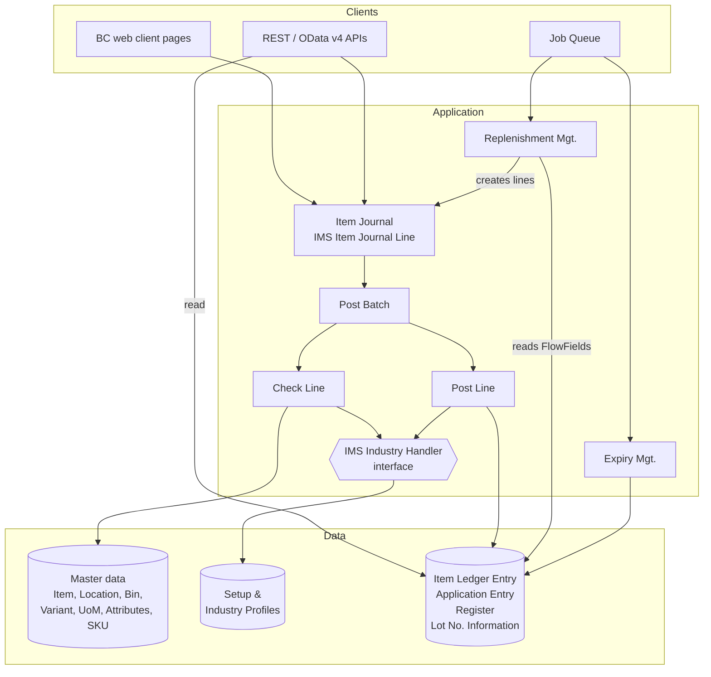
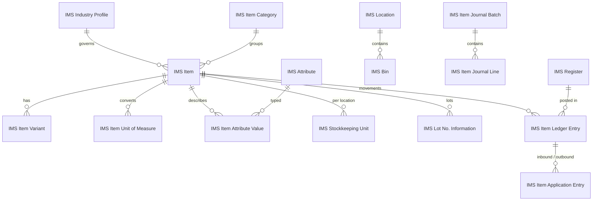
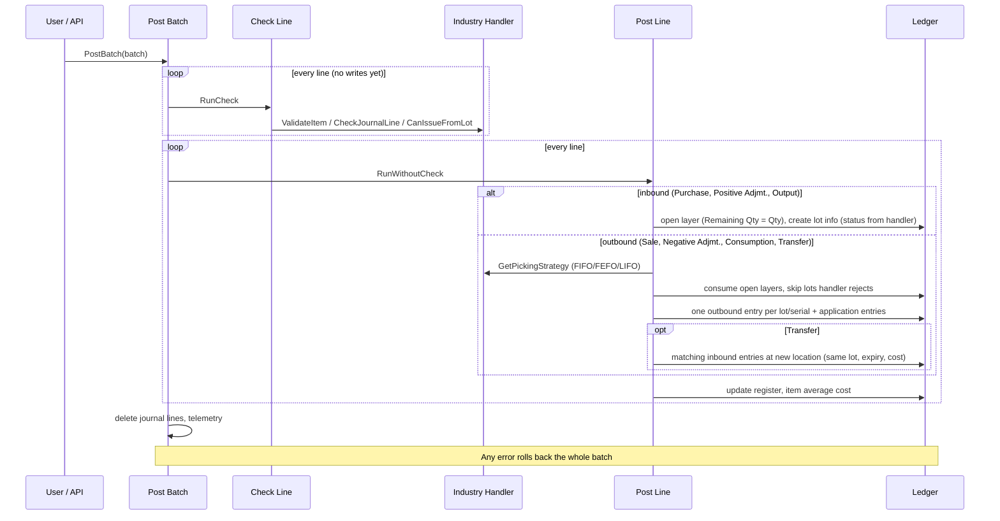

# Architecture

## 1. Design principles

| Principle | How it is applied |
|---|---|
| NAV posting pattern | Users never write stock directly. They create **journal lines**, which are validated by *Check Line* and turned into **immutable ledger entries** by *Post Line*. History is never changed – corrections are new entries. |
| Ledger is the single source of truth | Inventory, value, lot and bin quantities are **FlowFields** summed from `IMS Item Ledger Entry` over SIFT‑indexed keys. Nothing stores a running "qty on hand", so concurrent postings do not fight over a balance row. |
| Separate *configuration* from *code* | `IMS Industry Profile` (data) holds per-industry defaults; `IMS Industry Type` (extensible enum) selects an `IMS Industry Handler` (interface) implementation for rules that need code. |
| Open/closed | The posting engine has no industry `case` statements. New industries, new entry types, new costing rules plug in via enum extensions, the interface and integration events. |
| Upgrade-safe | Extension only (no base-app modifications), install/upgrade codeunits, events instead of code changes. |

## 2. Layered view

## 3. Data model

### Object map (IDs 50100–50149)

| Area | Tables | Pages | Codeunits |
|---|---|---|---|
| Setup | 50100 Setup | 50100 Setup | 50100 Install, 50109 Upgrade |
| Industry | 50101 Industry Profile | 50101 Industry Profiles | 50101 Industry Mgt., 50110 Base Rules, 50111–50116 handlers |
| Item | 50102 Category, 50103 Item, 50104 Variant, 50105 UoM, 50106 Item UoM, 50109 Attribute, 50110 Attribute Value, 50117 SKU | 50103–50108, 50111, 50112, 50119 | 50108 GTIN Mgt. |
| Location | 50107 Location, 50108 Bin | 50109, 50110 | |
| Tracking | 50111 Lot No. Information | 50113 | 50107 Expiry Mgt. |
| Journal / posting | 50112 Batch, 50113 Line | 50114, 50115 | 50102 Check Line, 50103 Post Line, 50104 Post Batch, 50105 Post (UI) |
| Ledger | 50114 Item Ledger Entry, 50115 Application Entry, 50116 Register | 50116–50118 | |
| Planning | 50118 Replenishment Line | 50120 | 50106 Replenishment Mgt. |
| API | | 50130–50133 | Query 50100 |

Enums 50100–50107, interface `IMS Industry Handler`, permission sets 50100–50102.

## 4. Posting flow

### Quantities and signs
Journal quantities are always **positive**; the entry type gives the direction. Ledger
quantities are signed (+ receipt, − issue). Everything in the ledger is in the **base unit**.

### Stock layers & application
Each inbound entry is a layer with `Remaining Quantity`/`Open`. An outbound posting
consumes layers in picking-strategy order and writes `IMS Item Application Entry` rows
(inbound entry, outbound entry, quantity, cost). This gives:

* **Actual** cost = cost of the consumed layers (FIFO, FEFO or LIFO depending on strategy).
  The last slice of a layer takes the remaining cost, so no rounding residue stays in stock.
* **Average** cost = `Inventory Value / Inventory`, recalculated after each posting.
* **Standard** cost = item standard cost for inbound and outbound.
* Full **traceability**: from any issue to the receipts (lots, suppliers) it came from, and back.

### Lot availability
A lot can be issued only when the industry handler's `CanIssueFromLot` returns true. Base
rules: `Blocked` – never (except scrap); `Quarantine` – only transfers; expired – blocked if
the profile says so; sales – minimum remaining shelf life. Pharma and Food always block expired
stock. Negative adjustments are always allowed so expired/blocked stock can be written off.

## 5. Scalability

| Concern | Approach |
|---|---|
| Large item ledgers (millions of rows) | Append-only ledger; balances via SIFT keys (`ItemLocationDate`, `ItemLot`, `LocationBin`) – SQL indexed views make sums O(1). Dedicated keys for open-layer lookups (`OpenLayers`, `OpenLayersFEFO`) so application only reads open receipts of one item/location. |
| Concurrency | No balance rows to update. The entry-no. lock is taken once per batch (NAV pattern). Item rows are locked only for the item being posted (average cost). Journals are per batch, so users/sites/devices post in parallel by using separate batches. |
| Read load | `SetLoadFields` on hot paths; ledger API page and the aggregated query use `DataAccessIntent = ReadOnly`, which routes to the read-only database replica. |
| Integrations | REST API for journal lines + bound `post` action lets POS, scanners, e-commerce and MES push movements in bulk (use `$batch`). Aggregated query avoids pulling raw entries into BI. |
| Background work | Planning and expiry blocking are UI-free and can run from the Job Queue. |
| Multi-company / multi-tenant | All data is per company; install/upgrade run per company; no hard-coded master data beyond idempotent seed values. |
| Observability | Optional telemetry (`IMS-0001`) with lines posted and duration per batch to Application Insights. |
| Extensibility without forks | Extensible enums, interface, and integration events on check, post, allocation, lot creation and planning. |

### Further scaling options
* If one company posts extremely high volumes, switch the ledger entry number to
  `AutoIncrement` (removes the per-batch lock) and move average-cost recalculation into a
  scheduled "adjust cost" job.
* Partition journals by site/device (`SITE1-POS`, `SITE2-WMS`, ...).
* Archive old closed layers / compress entries by period if required.

## 6. Security

* `IMS - READ`: read everything.
* `IMS - EDIT`: maintain master data and journals; ledgers granted **indirectly** (`Rim`) so
  they can only be written through the posting codeunit (`Permissions` property).
* `IMS - ADMIN`: additionally setup and industry profiles.
* Lot status changes are stamped with user and time.

## 7. Known limitations / roadmap

* Negative inventory is not allowed (issues must be covered by available stock).
* Purchase/sales documents, warehouse pick/put-away documents and general-ledger integration are
  out of scope; integrate them by creating journal lines (or extend via events).
* Standard cost variances are not posted to a variance account.
* For a deployment that also uses the standard BC Item table, a variant of this design can
  `tableextension` the base `Item` instead of using `IMS Item`; the industry interface and
  posting rules carry over unchanged.
